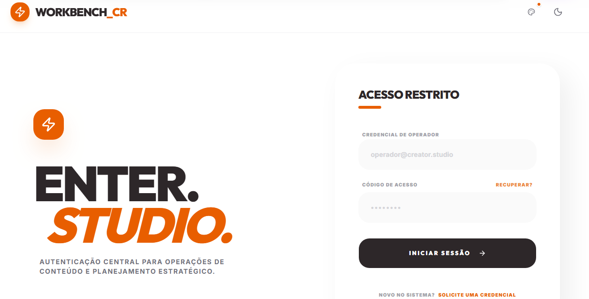
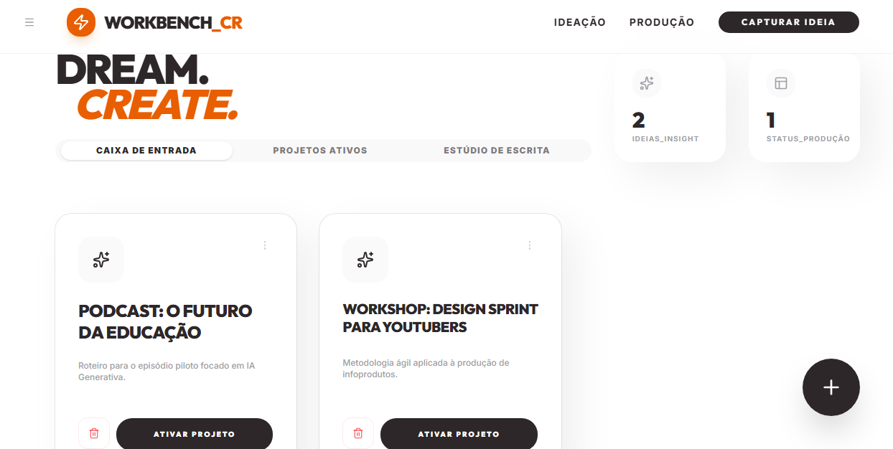
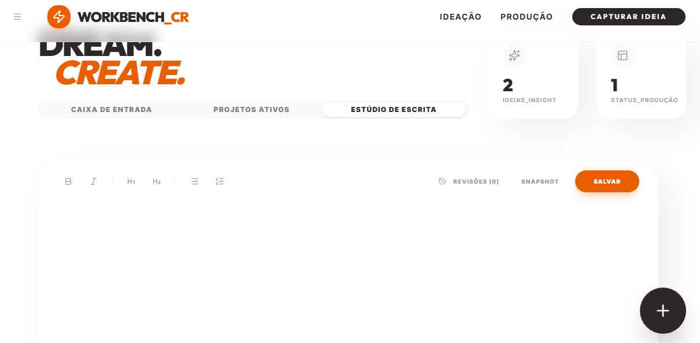
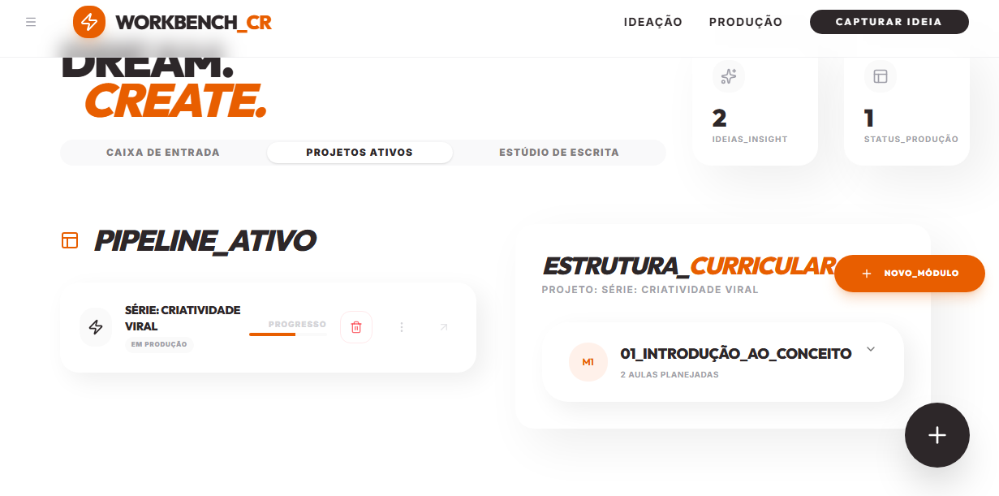
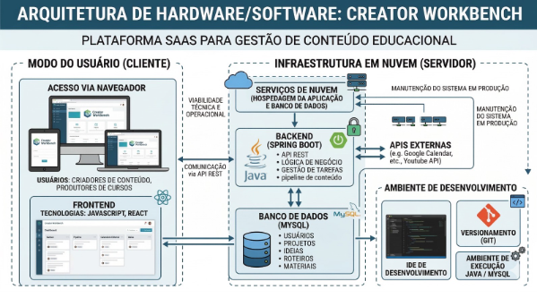

<h1 align="center">Creator Workbench</h1>

<p align="center">
  Plataforma web de <em>Content Operations</em> (ContentOps) para criadores de conteúdo educacional digital
</p>

<p align="center">
  <a href="docs/TCC-Creator-Workbench.pdf"><strong>📄 Ler o TCC (PDF)</strong></a> ·
  <a href="https://github.com/HenriqueOrsoni/Creator-Workbench">Front-end</a> ·
  <a href="https://github.com/luciano-araujo/ifsp-projeto-extensao">Back-end</a>
</p>

<p align="center">
  
  
  
  
</p>

---

## Sobre o projeto

Trabalho da disciplina **Projeto Integrado de Extensão 1** do curso de Tecnologia em Análise e Desenvolvimento de Sistemas do **Instituto Federal de São Paulo (IFSP), Campus São Paulo** (Grupo 01).

O crescimento da *Creator Economy* e do ensino a distância criou uma demanda que ferramentas genéricas como Trello, Notion e Asana não atendem bem, porque não têm estrutura própria para o domínio educacional. O **Creator Workbench** centraliza o fluxo de produção de quem cria cursos digitais: da ideia ao roteiro, dos ativos à estrutura curricular.

### Principais funcionalidades

-  **Gestão de ideias**: captura rápida de *insights* em uma caixa de entrada
-  **Workflow Kanban** com os estados de produção do conteúdo
-  **Estúdio de escrita**: editor de roteiros com formatação e histórico de versões
-  **Upload de ativos digitais** integrado ao AWS S3
-  **Estrutura curricular** em Cursos → Módulos → Aulas
-  **Automações** via scripts em Python

## Telas

| Login | Dashboard |
|:---:|:---:|
|  |  |
| **Estúdio de Escrita** | **Projetos Ativos** |
|  |  |

## Arquitetura e tecnologias



| Camada | Tecnologia |
|---|---|
| Front-end | React.js / Next.js |
| Back-end | Java + Spring Boot (API REST) |
| Banco de dados | MySQL (normalizado até a 3FN) |
| Infraestrutura | AWS (EKS, ECR, RDS, S3, CloudWatch) + Docker |
| Segurança | JWT, BCrypt, HTTPS, adequação à LGPD |
| Processo | Scrum com Sprints quinzenais + GitHub Projects |

## Equipe

| Integrante | Papel |
|---|---|
| Luciano Ricardo Paim de Araujo | Tech Lead e Engenheiro de Back-end |
| Vitoria de Lima Santos | Product Owner e Analista de Documentação |
| Henrique Orsoni | Engenheiro de Front-end |
| Renato Vanil de Oliveira | DBA / Arquiteto de Dados |
| Augusto Henrique Braga Silva | Engenheiro de Automação e DevOps |

**Orientação:** Prof. Me. Marcelo Tavares de Santana e Prof. Me. Johnata Souza Santicioli

## Estrutura do repositório

```
Projeto-Integrado/
├── docs/
│   └── TCC-Creator-Workbench.pdf   ← versão compilada do trabalho
├── tcc/                            ← código-fonte LaTeX do TCC
│   ├── documento.tex               ← arquivo principal (compile este)
│   ├── bibliografia.bib            ← referências (BibTeX)
│   ├── configuracoes/              ← título, autores, orientador, fontes, cores
│   ├── estrutura/                  ← ordem das partes (pré-textual, textual, pós-textual)
│   ├── pre-textual/                ← resumo, abstract, agradecimentos, siglas...
│   ├── capitulos/                  ← introdução, fundamentação, metodologia, resultados...
│   ├── pos-textual/                ← referências, apêndices, anexos
│   ├── imagens/                    ← figuras, diagramas e telas
│   └── abntex-ifpi/                ← modelo ABNT (não editar)
├── .github/workflows/              ← compila o PDF automaticamente a cada push
├── .gitignore
└── LICENSE
```

## Como compilar o TCC

**Overleaf:** envie a pasta `tcc/` (compactada em `.zip`) em *New Project → Upload Project* e compile `documento.tex`.

**Localmente** (com TeX Live ou MiKTeX instalado):

```bash
cd tcc
latexmk -pdf documento.tex
```

**VS Code:** abra a pasta `tcc/` com a extensão *LaTeX Workshop*; as configurações já estão em `tcc/.vscode/settings.json`.

**GitHub Actions:** a cada alteração em `tcc/`, o workflow *Compilar TCC* gera o PDF e o deixa disponível para download na aba **Actions**.

## Créditos

O modelo LaTeX é baseado no [abnTeX2](https://github.com/abntex/abntex2) e no [abntex-ifpi](https://g0dkar.github.io/abntex-ifpi/), de Rafael Madureira Lins de Araújo, com adaptações do Prof. Tulio Vidal (IFPI, Campus Corrente). Licença MIT: veja [LICENSE](LICENSE).
